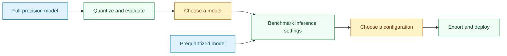

# InferBoost · Model Quantization & Inference Tuning

[简体中文](README.md) | **English**

**Start with a model directory. Quantize, compare results, tune inference, and export a deployment bundle.**

InferBoost provides a two-stage workflow for supported, directly loadable Hugging Face models: compare quantization candidates, then benchmark inference configurations for the model you choose. Prequantized models can enter stage two directly. Each stage produces a terminal summary and Markdown / HTML reports. Recommendations help you decide; the final choice is yours.

[Quick start](#quick-start) · [Container image](#container-image-and-requirements) · [Quantization recipes](#quantization-recipes) · [Outputs and deployment](#outputs-and-deployment) · [Documentation](#development-and-documentation)

## Default acceleration settings

| Default | What it does | When it helps |
| --- | --- | --- |
| KV Cache: enabled | Reuses previously computed keys and values during generation | A basic inference mechanism |
| Prefix caching: enabled | Reuses computation across requests with matching prefixes | Depends on prefix reuse and cache hits |
| Chunked prefill: enabled | Splits long prompts into chunks for scheduling | Affects how long prompts share resources with other requests |
| KV cache precision: `auto` | Lets the runtime choose based on the model configuration | Independent of weight / activation quantization |

These are defaults for the stage-two search, not separately benchmarked on/off ablations. The actual settings and startup commands are saved with each run. **MTP draft weights retain their original precision and are not quantized with the main model.** MTP decoding is tested only when you supply a matching, supported draft that passes validation.

## Workflow



| Stage | Input | What is compared | Output |
| --- | --- | --- | --- |
| Quantization and evaluation | Full-precision model, optional custom test data | Test-set score, regressions, weight size, resource use, TTFT / E2E / TPS | Quantized weights, reports, `selected_model.json` |
| Inference tuning | Selected model, optional MTP draft | Attention → matrix kernels → compilation and CUDA Graph → scheduling budget → MTP | Configuration comparisons, selection rationale, deployment bundle |
| Deployment | Selected weights and configuration | Model identity and real-request validation | A service startup script |

Candidates are filtered by model structure, GPU capabilities, and runtime support. Incompatible options show a reason; failed candidates retain their logs. Results apply to the tested model, hardware, and workload and do not establish a global optimum. [Architecture guide](docs/architecture.md)

## Container image and requirements

| Item | Details |
| --- | --- |
| Image | `ghcr.io/neaoo/inferboost:0.5.0-cu130-r11` |
| Registry page | [GitHub Container Registry](https://github.com/users/NeAoo/packages/container/package/inferboost) |
| Version and digest | [0.5.0-r11 release record](docs/releases/0.5.0-r11.md), including the full digest, build commit, and validation scope |
| OS and GPU | Linux amd64, NVIDIA SM80 or newer; FP8 recipes have additional requirements; V100 / SM70 is unsupported |
| Docker host | NVIDIA driver, Docker, and NVIDIA Container Toolkit already installed |
| Main image components | CUDA 13.0, vLLM 0.33.0, LLM Compressor 0.15.0; separate Python environments for quantization, inference, and the terminal UI |
| Bring your own | A complete, loadable model; an optional matching MTP draft; a writable persistent workspace |

The image has been uploaded and its digest verified. **Anonymous access has not yet passed verification.** Until the package is public, pulling requires a GHCR account with read access to this package; check the release record for the latest status. Model weights are not included. You do not need to install Torch or vLLM on the Docker host.

Fresh quantization downloads calibration data from a pinned public dataset revision, or uses a prepared offline snapshot. Tuning a prequantized model does not require calibration data. Inference uses **TP=1**: the original model and each candidate must fit individually on one GPU. Allocate disk space for all candidates and intermediate files, and size CPU / GPU memory for your model and workload. [Resource configuration](docs/configuration.md) · [Offline calibration](docs/data-and-evaluation.md#离线校准)

## Quick start

| Your environment | Start here |
| --- | --- |
| Linux GPU host with Docker access | Pull the image, create a container, and open the menu below |
| A cloud instance already using this image | Go to [Inside an InferBoost container](#inside-an-inferboost-container) and run `quickstart` |
| You want to modify the source | Use [Source development](#gpu-server-installation-and-source-development) with the matching runtime |

### Start with Docker

**1. Pull the pinned version.**

```bash
docker pull --platform linux/amd64 ghcr.io/neaoo/inferboost:0.5.0-cu130-r11
```

**2. Create a container with model and workspace mounts.** Replace `/absolute/models` with your existing model directory and `/absolute/persistent-work` with your writable persistent directory:

```bash
docker run -d --name inferboost --init --gpus all --shm-size=16g \
  -v /absolute/models:/models:ro \
  -v /absolute/persistent-work:/workspace \
  ghcr.io/neaoo/inferboost:0.5.0-cu130-r11 idle
```

**3. Open the interactive menu.**

```bash
docker exec -it inferboost quickstart
```

Enter **container paths**, not host paths, in the wizard:

| Content | Example host path | Path to enter |
| --- | --- | --- |
| Main model | `/absolute/models/source` | `/models/source` |
| Optional MTP draft | `/absolute/models/draft` | `/models/draft`; leave blank if absent |
| Workspace | Outputs under `/absolute/persistent-work` | `/workspace/inferboost-v050` by default, or choose another directory in the wizard |

The main model directory must contain `config.json`, model weights, and tokenizer files. InferBoost accepts complete models; training and LoRA merging are outside its workflow. To use a test dataset stored elsewhere, add `-v /absolute/test-data:/data:ro` when creating the container, then use `/data/tests.jsonl`.

Run `docker exec -it inferboost quickstart` again to reconnect. If the container is stopped, run `docker start inferboost` first. Use a new workspace when upgrading; previous tasks and weights stay in the old directory.

To call the final deployment API from the host, add `-p 127.0.0.1:9001:9001` to `docker run` when creating the container. First run quantization and tuning; the persistent model service starts when you launch a [selected deployment bundle](#outputs-and-deployment).

### Inside an InferBoost container

On a cloud platform that has already started this image, mount your model and a writable persistent volume, then run:

```bash
export PIPELINE_WORKSPACE=/mnt/persistent/inferboost
quickstart
```

Replace the workspace with your platform's actual mounted path. The wizard checks resources and model structure, then guides you through recipes, test data, and search budgets.

The terminal UI currently uses Chinese labels. These are the main actions:

| Menu label | Action |
| --- | --- |
| 新模型 | Quantize → evaluate → select → tune → export a deployment bundle |
| 已有量化模型 | Skip quantization and tune an existing quantized model |
| 任务中心 | Watch tasks, select results, or resume a run |
| 从旧工作目录重新选模型 | Reuse quantized artifacts from an older workspace |
| 启动已有部署包 | Start an existing deployment bundle |
| 工作目录 · 更换存储路径 | Change the workspace directory |
| 环境自检与存储说明 | Inspect the environment and storage |

**Change storage:** use the workspace menu item or run `quickstart workspace`. You can choose a new empty directory or a workspace initialized by the same image version. The wizard shows storage and mount information and remembers recent selections. Switching does not move old tasks or stop background jobs. [Storage rules](docs/terminal-interaction.md#更换存储路径)

Path input supports Tab completion; selectors use arrow keys and Space. `:b` goes back one step and `:q` returns to the menu. In the task dashboard, `L` shows live logs, `Q` exits the viewer, and `S` asks to stop the task. [Terminal guide](docs/terminal-interaction.md)

| Mode | Purpose | Default scope |
| --- | --- | --- |
| Quick | Check the complete workflow | Original model + GPTQ4, 64 calibration samples, 10 evaluation samples, 1 performance repeat |
| Standard | Compare candidates and make a selection | Compatible GPTQ4 / AWQ4 / GPTQ8 / W8A8 recipes, 512 calibration samples, full evaluation, 3 performance repeats |
| Custom | Set your workload and budget | Select recipes, calibration size, datasets, repeat counts, and search budget |

Quick-mode reports are labelled as workflow checks. For a deployment decision, use a full comparison and include data representative of your application.

### GPU server installation and source development

- **GPU server:** use the [Docker installer](docs/installation.md) and run `inferboost` on the host.
- **Cloud development instance:** import the image, mount your directories, and run `quickstart` inside the container. [First-run guide](docs/sandbox-quickstart.md)
- **Source development:** mount the repository into the matching runtime. [Contributor guide](CONTRIBUTING.md)

Source-only use still needs matching quantization and inference environments. The recommended development setup uses the Docker installer first, then the source checkout:

```bash
git clone https://github.com/NeAoo/InferBoost.git
inferboost dev /absolute/InferBoost
```

Here, `inferboost` is the host command installed by the Docker installer. If you are already inside the matching image, run `PIPELINE_PYTHON=/opt/inferboost-ui/bin/python ./quickstart` from the cloned repository. Installing the lightweight UI dependencies with `pip` does not provision the CUDA / vLLM runtime.

### Command-line workflows

```bash
# Complete workflow; omit --mtp-model if no draft is available.
quickstart workflow --model /models/source --mtp-model /models/draft \
  --mode standard --gpus 0 --run-id first-model

# Tune a model that is already quantized.
quickstart workflow --model /models/quantized --skip-quantization \
  --run-id tune-model
```

By default, the workflow pauses for your model and configuration selections. `--auto-select` allows it to continue with recommendations. `--dataset /data/tests.jsonl` adds custom test data. Direct CLI workflows run in the foreground; the enhanced wizard submits background tasks. [CLI reference](docs/cli-reference.md)

## Quantization recipes

Fresh quantization uses **LLM Compressor**; inference uses **vLLM**. Architecture detection reads `config.json` and inspects actual module structure. Registered adapters include Llama, Qwen2/3 dense and MoE, Qwen3-Next, and Qwen3.5 dense and MoE. Registration means an adapter exists; a particular model still needs export, loading, and evaluation checks.

**W is weight precision; A is input activation precision for quantized linear layers.** Weight-only recipes default to A16 (BF16). A8 / AFP8 recipes also quantize activations. KV cache precision, accumulation, sensitive layers, and MTP precision are managed separately.

| Recipe | Method | W / A | Main requirements |
| --- | --- | --- | --- |
| `gptq4` | GPTQ: uses calibration data to compensate for weight quantization error | INT4 / BF16 · W4A16 | SM80+, model adapter required |
| `gptq8` | GPTQ | INT8 / BF16 · W8A16 | SM80+, model adapter required |
| `w8a8` | GPTQ + dynamic per-token INT8 activations | INT8 / INT8 · W8A8 | SM80+, matching activation kernels required |
| `awq4` | AWQ: activation-aware scaling before quantization | INT4 / BF16 · W4A16 | SM80+, complete branch mappings required |
| `awq_gptq4` | AWQ scaling followed by GPTQ quantization | INT4 / BF16 · W4A16 | SM80+, complete branch mappings required |
| `w4afp8` | AWQ + dynamic FP8 activations | INT4 / FP8 · W4AFP8 | SM90+; experimental; currently excluded for MoE |
| `fp8` | RTN + dynamic FP8 activations | FP8 / FP8 | SM89+, model and kernel support required |

`all` tries registered, eligible recipes and records why others are skipped. W4AFP8 is different from INT4 / INT8; there is currently no W4A8-INT8 recipe. [Quantization architecture](docs/quantization-architecture.md) · [Qwen / MoE adapters](docs/qwen-quantization.md)

## Choosing a result

Standard quantization uses 512 PerfectBlend calibration samples, capped at 4096 tokens each. Independent scoring uses 100 rule-based questions. Quality is evaluated once; performance runs three times, with cold / warm results kept separate. The default questions support engineering checks, not a claim of general model accuracy. Supply labelled JSON / JSONL data for application-specific comparisons; unlabelled data produces performance results only.

For quantization, check the quality gates before comparing size, latency, or score according to your preference. Defaults allow at most a 5-point drop on the 100-point score scale and at most 3 original-correct / quantized-wrong regressions. Each labelled dataset is checked separately; these thresholds are configurable. For inference tuning, recommendations compare mean E2E in the target cache condition among complete candidates that pass quality revalidation. Review TTFT, TPS, and resource costs before choosing. [Data and evaluation](docs/data-and-evaluation.md) · [Metric definitions](docs/reporting.md)

## Outputs and deployment

```text
$PIPELINE_WORKSPACE/
├── runs/<run>-quant/
│   ├── candidates/<recipe>/quantized/  New quantized weights
│   ├── selected_model.json            Selected model and provenance
│   └── report.md / report.html
├── runs/inference/<run>-accel/        Tuning results and per-request records
├── runs/workflows/<run>/deployment/   start.sh and deployment configuration
├── jobs/<run>/                       Background state and logs
└── cache/                            Compilation and runtime caches
```

Deployment bundles reference weights rather than copying them. The `artifact` field in `model_manifest.json` records the actual weight location. When migrating, retain the selected weights, optional MTP draft, and deployment bundle together.

```bash
# Example port; adjust it for your deployment environment.
quickstart deploy --bundle "$PIPELINE_WORKSPACE/runs/workflows/first-model/deployment" \
  --host 0.0.0.0 --port 9001
```

The API is `/v1/chat/completions`; the health endpoint is `/health` on the same port. Add `--smoke-test` to validate one real request and exit. For host access, configure the Docker port mapping when creating the container. [Deployment and migration](docs/cli-reference.md#部署包)

## Development and documentation

```text
pipeline/       Orchestration, quantization, evaluation, reports, jobs, deployment
  inference/    Compatibility planning, service lifecycle, staged search
installer/      Docker installation and source-development commands
scripts/        Backend execution, calibration preparation, packaging, verification
configs/        Generic configuration examples
image/          Image builds and workspace initialization
requirements/   Component dependencies and hash locks
data/           Default quality and performance datasets; calibration is prepared per run
tests/          Lightweight maintenance tests
docs/           Usage, architecture, and maintenance guides
```

| Topic | Documentation |
| --- | --- |
| Installation, startup, source development | [Installation](docs/installation.md) · [Contributing](CONTRIBUTING.md) |
| Resources, ports, data, recommendation rules | [Configuration](docs/configuration.md) |
| Quantization and inference search implementation | [Stage one](docs/quantization-architecture.md) · [Stage two](docs/stage2-inference.md) |
| Terminal navigation, resuming, results | [Interaction](docs/terminal-interaction.md) · [CLI](docs/cli-reference.md) |
| Linghui online development | [Platform adaptation](docs/platforms/linghui.md) |
| Image builds, source synchronization, validation | [Image delivery](docs/image-delivery.md) · [Release checks](docs/release-readiness.md) |

The repository defaults to the [Chinese README](README.md). The language links switch documentation; the terminal UI and detailed guides are currently primarily in Chinese.

Source, images, and initialized workspaces have separate version identities. A Git commit or push does not modify an already-built image. Each image release records its build source and immutable digest. Run outputs, caches, private configuration, and user weights are excluded from the shared repository.

## Upstream projects and licensing

InferBoost uses [LLM Compressor](https://github.com/vllm-project/llm-compressor) and [vLLM](https://github.com/vllm-project/vllm). Its workflow design draws on [LightCompress](https://github.com/ModelTC/LightCompress) and [Olive](https://github.com/microsoft/Olive).

Current version: **0.5.0-r11**. Source: [NeAoo/InferBoost](https://github.com/NeAoo/InferBoost). A formal open-source license has not yet been selected. Image availability and validation scope are recorded in the [release notes](docs/releases/0.5.0-r11.md). Model weights are not distributed with the source or image. [License status](LICENSE-NOTICE.md) · [Third-party notices](THIRD_PARTY_NOTICES.md) · [Changelog](CHANGELOG.md)
