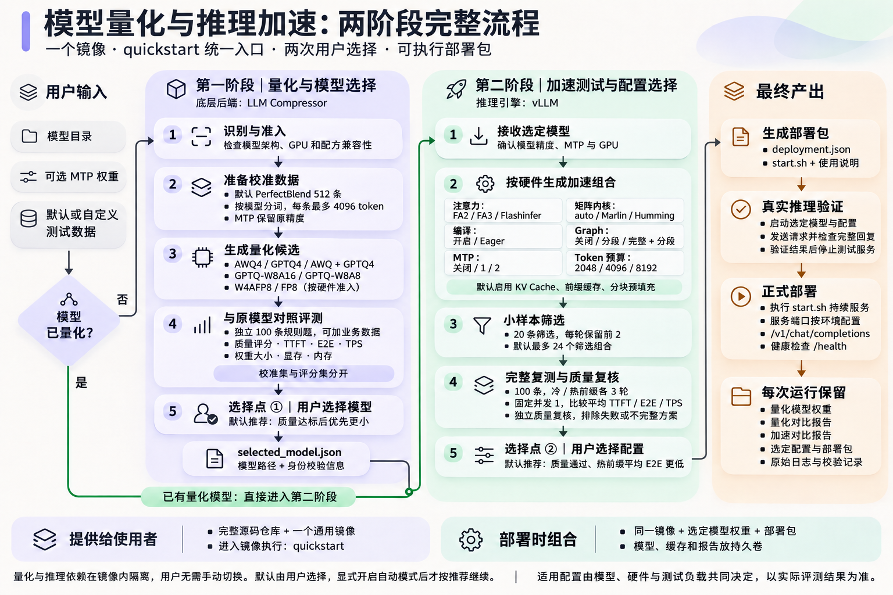

# InferBoost · 模型量化与推理加速

**简体中文** | [English](README.en.md)

**从一个模型目录开始，完成量化、效果对比、推理调优和部署。**

InferBoost 为可直接加载的 Hugging Face 模型提供两阶段工作流：先比较量化模型，再为选定模型测试推理配置。已有量化模型可以直接进入第二阶段。每一步都有终端摘要和 Markdown / HTML 报告，推荐供参考，最终由使用者选择。

[快速开始](#快速开始) · [镜像与运行环境](#镜像与运行环境) · [量化配方](#量化配方) · [输出与部署](#输出与部署) · [安装](docs/installation.md) · [配置](docs/configuration.md) · [开发](CONTRIBUTING.md)

## 默认加速设置

| 默认项 | 作用 | 适用说明 |
| --- | --- | --- |
| 普通 KV Cache：开启 | 生成时复用此前的 Key/Value | 推理引擎的基础机制 |
| 前缀缓存：开启 | 跨请求复用相同输入前缀 | 收益取决于重复前缀和缓存命中情况 |
| 分块预填充：开启 | 将长输入拆分处理 | 影响长输入与其他请求之间的调度 |
| KV 精度：`auto` | 由框架和模型配置决定 | 独立于模型的 W/A 量化精度 |

这些是第二阶段搜索的默认项，搜索不逐项比较其开关。实际配置和启动命令随任务保存。**MTP 草稿保持原精度，不参与主模型量化**；提供匹配草稿并通过检查后，第二阶段才测试 MTP 解码。

## 工作流



| 阶段 | 输入 | 比较内容 | 输出 |
| --- | --- | --- | --- |
| 量化与评测 | 完整精度模型、可选测试数据 | 本测试集得分、退化题、权重大小、资源、TTFT / E2E / TPS | 量化权重、对比报告、`selected_model.json` |
| 推理加速 | 选定模型、可选 MTP | 注意力 → 矩阵内核 → 编译与 Graph → 调度预算 → MTP | 配置对比、逐阶段选择依据、部署包 |
| 部署 | 选定权重与配置 | 模型身份核验、真实请求验证 | 可持续运行的服务启动脚本 |

候选按模型结构、GPU 能力和运行时依赖过滤。不兼容项显示原因，失败项保留日志。搜索结果适用于所测模型、硬件和负载，不保证全局最优。[流程与模块地图](docs/architecture.md)

## 镜像与运行环境

| 项目 | 说明 |
| --- | --- |
| 镜像地址 | `ghcr.io/neaoo/inferboost:0.5.0-cu130-r11` |
| 镜像包 | [GitHub Container Registry](https://github.com/users/NeAoo/packages/container/package/inferboost) |
| 版本与摘要 | [0.5.0-r11 发布记录](docs/releases/0.5.0-r11.md)，包含完整 digest、构建提交及验证范围 |
| 系统与 GPU | Linux amd64、NVIDIA SM80 及以上；FP8 配方另有硬件条件；V100 / SM70 不支持 |
| 使用 Docker 的主机 | 已安装 NVIDIA 驱动、Docker 与 NVIDIA Container Toolkit |
| 镜像内主要组件 | CUDA 13.0、vLLM 0.33.0、LLM Compressor 0.15.0；量化、推理、终端 UI 使用隔离 Python 环境 |
| 自己准备的内容 | 可直接加载的完整模型、可选且匹配的 MTP 草稿、可写持久工作目录 |

镜像已上传并核对摘要，**当前匿名拉取仍未通过验证**。公开可见性开启前，需使用有该包读取权限的 GHCR 账号登录；最新状态以发布记录为准。模型权重不在镜像中，无需在宿主另装 Torch / vLLM。

首次量化需要联网读取固定版本的公开校准数据，也支持提前准备离线快照；已有量化模型直接进入加速阶段时不需要校准下载。推理固定 **TP=1**，原模型和每个候选都需能单卡加载。磁盘应容纳所有候选与中间产物，内存和显存按模型及负载配置。[资源要求](docs/configuration.md) · [离线校准](docs/data-and-evaluation.md#离线校准)

## 快速开始

| 你所在的环境 | 从哪里开始 |
| --- | --- |
| Linux GPU 主机，有 Docker 权限 | 按下面三步拉取镜像、创建容器、打开菜单 |
| 云平台已用此镜像创建实例 | 直接看[已进入 InferBoost 镜像](#已进入-inferboost-镜像)，运行 `quickstart` |
| 需要修改代码 | 看[源码开发](#gpu-服务器或源码开发)，复用镜像里的运行环境 |

### Docker 快速启动

**1. 拉取固定版本。**

```bash
docker pull --platform linux/amd64 ghcr.io/neaoo/inferboost:0.5.0-cu130-r11
```

**2. 创建容器并挂载模型与工作目录。** 将 `/absolute/models` 替换为已有模型的宿主目录，将 `/absolute/persistent-work` 替换为自己的可写持久目录：

```bash
docker run -d --name inferboost --init --gpus all --shm-size=16g \
  -v /absolute/models:/models:ro \
  -v /absolute/persistent-work:/workspace \
  ghcr.io/neaoo/inferboost:0.5.0-cu130-r11 idle
```

**3. 打开交互菜单。**

```bash
docker exec -it inferboost quickstart
```

向导填写的是**容器内路径**：

| 内容 | 宿主路径示例 | 向导内填写 |
| --- | --- | --- |
| 主模型 | `/absolute/models/source` | `/models/source` |
| MTP 草稿（可选） | `/absolute/models/draft` | `/models/draft`；没有则留空 |
| 工作目录 | `/absolute/persistent-work` 下的产物 | 默认 `/workspace/inferboost-v050`，也可在向导中选择 |

主模型目录应包含 `config.json`、模型权重和 tokenizer 文件。本项目接收完整模型，不承担训练或 LoRA 合并。自定义数据若在其他目录，可在创建容器时另加 `-v /absolute/test-data:/data:ro`，之后使用 `/data/tests.jsonl`。

再次连接时重复 `docker exec -it inferboost quickstart`；容器已停止则先运行 `docker start inferboost`。新版本请使用新的工作目录，原任务与权重保留在旧目录。

如需从宿主调用最终部署 API，在创建容器时给 `docker run` 增加 `-p 127.0.0.1:9001:9001`。容器就绪后先运行量化与调优；只有启动[选定部署包](#输出与部署)才会持续提供模型服务。

### 已进入 InferBoost 镜像

将模型目录和可写持久卷挂载到容器，设置工作目录后运行：

```bash
export PIPELINE_WORKSPACE=/mnt/persistent/inferboost
quickstart
```

把路径替换为平台实际挂载位置。向导会检查资源和模型结构，引导选择配方、测试数据与预算。

```text
InferBoost · 模型量化与推理加速

› 新模型 · 量化 → 评测 → 加速 → 部署
  已有量化模型 · 直接加速
  任务中心 · 续看 / 选择 / 续跑
  从旧工作目录重新选模型 · 复用量化结果
  查看原有任务与报告
  启动已有部署包
  工作目录 · 更换存储路径
  环境自检与存储说明
  退出
```

**更换存储路径**：主菜单选择“工作目录 · 更换存储路径”，或运行 `quickstart workspace`。支持新空目录与本镜像同版本的已有目录，显示磁盘与挂载信息，并记住最近选择。旧任务与结果保留原位置；切换不迁移文件、不停止后台任务。[存储规则](docs/terminal-interaction.md#更换存储路径)

路径输入支持 Tab 补全，选项支持方向键与空格。`:b` 返回上一步，`:q` 返回菜单。任务看板显示阶段、资源和进度；`L` 展开实时日志，`Q` 退出查看，`S` 确认停止任务。[交互操作](docs/terminal-interaction.md)

| 模式 | 用途 | 默认范围 |
| --- | --- | --- |
| 快速体验 | 验证完整链路 | 原模型 + GPTQ4，64 条校准、10 条评测、性能 1 轮 |
| 标准对比 | 对比候选并选择 | GPTQ4 / AWQ4 / GPTQ8 / W8A8 中兼容项，512 条校准、完整评测、性能 3 轮 |
| 自定义 | 自定负载与预算 | 自选配方、校准规模、测试集、重复次数与搜索预算 |

快速体验报告标记为链路验证。正式选择建议使用标准对比，并加入代表实际业务的数据。

### GPU 服务器或源码开发

- **GPU 服务器**：使用 [Docker 安装器](docs/installation.md)，在宿主运行 `inferboost`。
- **云端开发实例**：导入镜像并挂载目录，在容器运行 `quickstart`。[首次运行指南](docs/sandbox-quickstart.md)
- **源码开发**：将仓库挂载到配套运行时，运行 `inferboost dev /absolute/source`。[开发指南](CONTRIBUTING.md)

只使用源码时，也需要匹配的量化与推理运行时。推荐先使用 [Docker 安装器](docs/installation.md#docker一键安装)，再将克隆的源码交给开发入口：

```bash
git clone https://github.com/NeAoo/InferBoost.git
inferboost dev /absolute/InferBoost
```

上面的 `inferboost` 是宿主安装器安装的启动命令。若已经位于配套镜像内，在克隆的仓库目录执行 `PIPELINE_PYTHON=/opt/inferboost-ui/bin/python ./quickstart` 即可。轻量 UI 的 `pip install` 不能替代 CUDA / vLLM 运行环境。

### 命令行

```bash
# 完整流程；没有 MTP 时省略 --mtp-model。
quickstart workflow --model /models/source --mtp-model /models/draft \
  --mode standard --gpus 0 --run-id first-model

# 已量化模型直接进行加速测试。
quickstart workflow --model /models/quantized --skip-quantization \
  --run-id tune-model
```

默认在模型与配置选择点等待用户决定。`--auto-select` 授权按推荐继续，`--dataset /data/tests.jsonl` 添加自定义测试。直接 CLI 在前台执行；增强向导提交后台任务。[完整 CLI 手册](docs/cli-reference.md)

## 量化配方

新量化统一使用 **LLM Compressor**，推理使用 **vLLM**。架构根据 `config.json` 和实际模块结构识别；已登记 Llama、Qwen2/3 dense 与 MoE、Qwen3-Next、Qwen3.5 dense 与 MoE。登记表示存在适配入口，各模型仍需完成真实导出、加载和评测。

**W 为权重，A 为被量化线性层的输入激活精度。** 仅权重量化默认 A16（BF16）；A8 / AFP8 另行量化激活。KV Cache、累加、敏感层与 MTP 的精度分别管理。

| 配方 | 方法 | W / A | 主要条件 |
| --- | --- | --- | --- |
| `gptq4` | GPTQ：用校准数据补偿权重量化误差 | INT4 / BF16 · W4A16 | SM80 起，需模型适配 |
| `gptq8` | GPTQ | INT8 / BF16 · W8A16 | SM80 起，需模型适配 |
| `w8a8` | GPTQ + 动态逐 token INT8 激活 | INT8 / INT8 · W8A8 | SM80 起，需对应激活内核 |
| `awq4` | AWQ：按激活分布缩放后量化 | INT4 / BF16 · W4A16 | SM80 起，需完整分支映射 |
| `awq_gptq4` | AWQ 缩放后再做 GPTQ 量化 | INT4 / BF16 · W4A16 | SM80 起，需完整分支映射 |
| `w4afp8` | AWQ + 动态 FP8 激活 | INT4 / FP8 · W4AFP8 | SM90 起；实验配方，MoE 暂不准入 |
| `fp8` | RTN + 动态 FP8 激活 | FP8 / FP8 | SM89 起，需模型与内核适配 |

`all` 尝试登记的兼容配方，并记录跳过原因。W4AFP8 与 INT4 / INT8 不同，当前没有 W4A8-INT8 配方。[量化架构](docs/quantization-architecture.md) · [Qwen / MoE 适配](docs/qwen-quantization.md)

## 如何选择结果

标准量化使用 PerfectBlend 512 条校准数据，每条最多 4096 token；独立评分使用 100 条规则题。质量评分 1 轮，性能 3 轮，分别记录 cold / warm。默认题用于工程检查，用户可上传带答案的 JSON / JSONL 进行业务对照；无答案数据只报告性能。

量化建议先检查质量门槛，再按用户偏好比较大小、延迟或得分。默认门槛为百分制下降不超过 5 分，且原对现错不超过 3 道；每份带答案数据分别检查，可通过配置调整。加速建议在完整、质量复核通过的候选中比较目标缓存状态的平均 E2E。用户可以查看 TTFT、TPS 和资源代价后自主选择。[数据与评测](docs/data-and-evaluation.md) · [指标定义](docs/reporting.md)

## 输出与部署

```text
$PIPELINE_WORKSPACE/
├── runs/<任务>-quant/
│   ├── candidates/<配方>/quantized/   新量化权重
│   ├── selected_model.json           已选模型及来源
│   └── report.md / report.html
├── runs/inference/<任务>-accel/       加速结果与逐请求记录
├── runs/workflows/<任务>/deployment/  start.sh 与部署配置
├── jobs/<任务>/                      后台状态和日志
└── cache/                            编译与运行缓存
```

部署包引用权重，不复制模型。真实权重位置以 `model_manifest.json` 的 `artifact` 为准；迁移时同时保留权重、可选 MTP 和部署包。

```bash
# 端口为示例，可按部署环境修改。
quickstart deploy --bundle "$PIPELINE_WORKSPACE/runs/workflows/first-model/deployment" \
  --host 0.0.0.0 --port 9001
```

接口为 `/v1/chat/completions`，健康检查为同端口 `/health`。添加 `--smoke-test` 可完成一条真实请求后退出。[部署与迁移](docs/cli-reference.md#部署包)

## 开发与文档

```text
pipeline/       编排、量化、评测、报告、任务与部署
  inference/    兼容规划、服务生命周期、分阶段搜索
installer/      Docker 安装与源码开发入口
scripts/        后端执行、校准准备、打包和校验
configs/        通用配置示例
image/          镜像构建与工作区初始化
requirements/   组件依赖与哈希锁
data/           默认质量题与性能请求；校准数据按任务准备
tests/          轻量维护测试
docs/           使用、架构和维护文档
```

| 需要了解 | 文档 |
| --- | --- |
| 安装、启动、源码开发 | [安装](docs/installation.md) · [贡献指南](CONTRIBUTING.md) |
| 资源、端口、数据与推荐规则 | [配置指南](docs/configuration.md) |
| 量化与推理搜索的实现 | [第一阶段](docs/quantization-architecture.md) · [第二阶段](docs/stage2-inference.md) |
| 终端、续跑、结果查看 | [交互](docs/terminal-interaction.md) · [CLI](docs/cli-reference.md) |
| 领慧在线开发适配 | [平台说明](docs/platforms/linghui.md) |
| 镜像构建、源码同步与验收 | [镜像交付](docs/image-delivery.md) · [发布检查](docs/release-readiness.md) |

README 默认使用中文，顶部可切换 [English](README.en.md)。语言切换作用于文档；当前终端交互与详细指南主要使用中文。

源码、镜像和已初始化的工作区分别管理版本。Git 提交或推送不会更新已构建镜像；每次镜像发布记录对应源码和不可变摘要。运行结果、缓存、私有配置和用户权重不进入共享仓库。

## 上游与许可

直接使用 [LLM Compressor](https://github.com/vllm-project/llm-compressor) 和 [vLLM](https://github.com/vllm-project/vllm)，流程设计参考 [LightCompress](https://github.com/ModelTC/LightCompress) 与 [Olive](https://github.com/microsoft/Olive)。

当前版本 **0.5.0-r11**。代码：[NeAoo/InferBoost](https://github.com/NeAoo/InferBoost)。正式开源许可证尚未确定；镜像上传状态与验收范围见 [发布说明](docs/releases/0.5.0-r11.md)。模型权重不随源码或镜像分发。[许可状态](LICENSE-NOTICE.md) · [第三方说明](THIRD_PARTY_NOTICES.md) · [变更记录](CHANGELOG.md)
