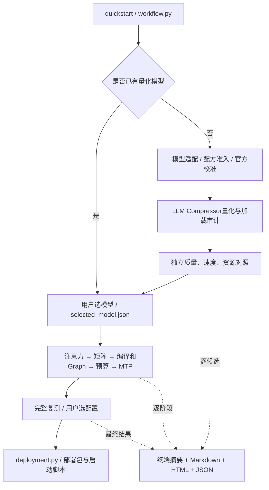
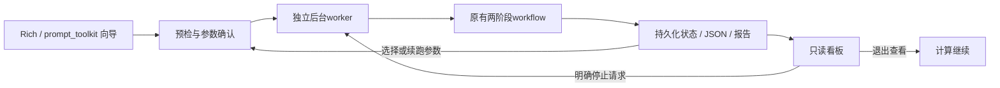

# 完整代码地图

入口是根目录的 `quickstart`；无参数进入 `pipeline/launcher.py` 的 InferBoost 交互入口（增强菜单或纯文本），整体协调器为 `pipeline/workflow.py`。
量化与加速是两套独立流程，通过 `selected_model.json` 交接，不把量化模型重复量化。

| 入口 / 模块 | 职责 |
| --- | --- |
| `installer/runtime.py`、`install.sh` | 宿主Docker安装、镜像身份、持久容器与开发源码挂载 |
| `quickstart`、`inferboost`、`accelerate` | Shell入口；完整交互流程或单独加速 |
| `pipeline/ui.py`、`guided.py` | Rich显示、prompt_toolkit输入、可回退向导；不执行量化算法 |
| `pipeline/preflight.py`、`modes.py` | 硬件/存储/模型预检与显式实验预算 |
| `pipeline/jobs.py`、`dashboard.py` | 独立后台任务、锁、状态与心跳；只读看板及显式停止 |
| `pipeline/measurement.py` | 独立质量一次与多轮性能；检查完整性、轮均值及波动 |
| `pipeline/diagnostics.py` | 按故障证据显示原因与恢复动作 |
| `pipeline/workflow.py` | 两阶段编排、用户选择、交接与部署导出 |
| `pipeline/quantization.py` | 第一阶段资源调度、候选量化及固定条件评测 |
| `pipeline/quantization_catalog.py` | 模型结构识别、量化配方与适配边界 |
| `pipeline/qwen_awq.py`、`awq_batching.py` | Qwen专家与路由缩放补偿核验、保持校准样本的前馈回放优化 |
| `pipeline/calibration.py`、`scripts/quantize_compressor.py` | 校准数据契约与LLM Compressor执行 |
| `pipeline/quality.py`、`pipeline/benchmark.py` | 规则评分、SSE请求与计时、cold/warm协议 |
| `pipeline/quantization_report.py`、`quantization_labels.py` | 量化对照、精度解释、排序及建议 |
| `pipeline/inference/planning.py` | 硬件与精度准入，生成候选参数与启动命令 |
| `pipeline/inference/execution.py` | 五步筛选、进度输出、保留备选、完整复测 |
| `pipeline/inference/native.py`、`server.py` | vLLM官方sweep适配、服务启停与加载审计 |
| `pipeline/inference/worker.py` | 预热、性能请求、独立质量请求、每轮原始记录 |
| `pipeline/inference/mtp_metrics.py` | MTP计数快照、区间差分、旧日志恢复与统计边界 |
| `pipeline/inference/decision_trace.py` | 按当时已知证据重建选择过程，禁止倒灌后续成绩 |
| `pipeline/inference/report.py`、`search_report.py`、`decision_view.py` | 最终结果与五步HTML报告 |
| `pipeline/text_report.py`、`pipeline/inference/text_report.py` | 同一结构化结果的Markdown与终端摘要 |
| `pipeline/deployment.py`、`pipeline/inference/deploy.py` | 部署交付、权重/环境校验、启动与冒烟测试 |
| `configs/`、`data/` | 示例配置、公共性能100条、独立带答案100条 |
| `requirements/`、`image/` | 依赖版本、镜像组装与工作目录初始化 |
| `pipeline/ipc.py` | 为vLLM本地通信创建短路径；模型、缓存和报告继续留在持久工作区 |
| `tests/`、`docs/`、`scripts/package_source.py` | 契约测试、文档、可分享源码打包 |

运行产生的模型、缓存与实验放在 `models/`、`cache/`、`runs/`；这些不进入公共源码包。
`runs/.../source/` 是每批实验的冻结代码，不能将当前开发代码覆盖进去。
`output/` 是源码包和报告交付目录，历史版本保留。

详细设计：[量化](quantization-architecture.md) · [加速](stage2-inference.md) · [报告](reporting.md) · [镜像](image-delivery.md)。

## 终端与计算解耦

UI独立位于`/opt/inferboost-ui`；量化`/opt/quantization`和推理`/opt/venv`依赖不因UI更新而改变。磁盘写入和UI渲染位于请求计时区间外，但系统监控仍可能有微小资源开销。`jobs/`是运行记录，不进入源码包。源码版本指纹不一致时拒绝混用结果。
