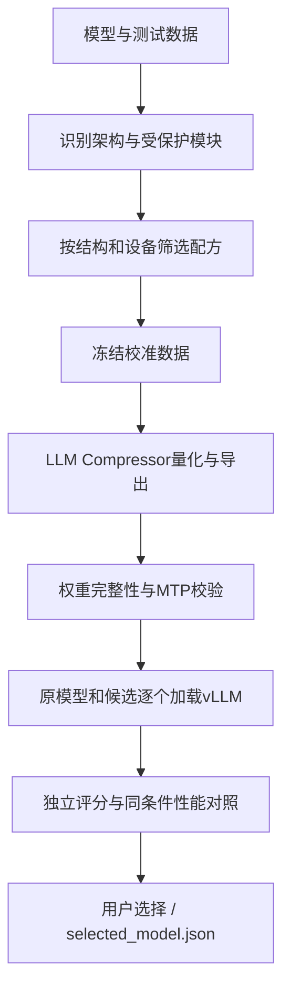

# 第一阶段：量化、评测与模型选择

第一阶段接受可直接加载的完整精度 Hugging Face 模型，通过 LLM Compressor 生成候选，并在统一条件下与原模型对照。输入已量化模型时直接进入第二阶段；训练和 LoRA 合并由上游完成。



## 后端与模块职责

| 层次 | 实现 | 职责 |
| --- | --- | --- |
| 模型适配 | `pipeline/quantization_catalog.py`、`pipeline/qwen_awq.py` | 识别结构、检查分支映射、保护敏感模块 |
| 配方 | `quantization_catalog.py` | 定义算法、W/A 精度、导出格式和最低 GPU 能力 |
| 编排 | `pipeline/quantization.py` | 数据冻结、任务调度、候选状态、恢复与选择 |
| 校准 | `pipeline/calibration.py`、`scripts/prepare_official_calibration.py` | 样本预处理、分词、来源与重复输入检查 |
| 后端执行 | `scripts/quantize_compressor.py` | 调用 Modifier、顺序校准与 compressed-tensors 导出 |
| 评测 | `pipeline/quality.py`、`pipeline/measurement.py` | 独立规则评分、重复性能测量与完整性检查 |
| 加载审计与报告 | `pipeline/quantization_audit_worker.py`、`pipeline/quantization_report.py` | 核验实际精度与内核，生成对照与建议 |

LLM Compressor 提供量化算法实现：AWQModifier 搜索缩放，QuantizationModifier / GPTQModifier 执行量化，oneshot 组织校准，compressed-tensors 打包权重。InferBoost 增加准入、数据契约、评测、恢复和交接。GPTQModel 仅保留旧产物复用身份，不作为新量化后端。

LightCompress 的结构适配与配置分层、Olive 的 Pass 编排和候选轨迹提供设计参考；它们不是当前流程的隐含运行依赖。上游来源与固定版本见 `references/upstream-lock.json`，第三方条款见[第三方说明](../THIRD_PARTY_NOTICES.md)。

## 架构识别与配方准入

首先读取 `config.json` 中的 `model_type` / `text_config`，再核对实际模块结构。目录名称、模型发布名称与参数规模不作为适配依据。

已登记的结构包括 Llama、Qwen2/3 dense 与 MoE、Qwen3-Next、Qwen3.5 dense 与 MoE。未知结构会明确拒绝，不默认套用其他模型的 AWQ 映射。视觉、音频及自定义远程代码不在当前文本评测契约内。Qwen MoE 的专家、路由与共享分支检查见[专用适配说明](qwen-quantization.md)。

| CLI 名称 | 后端配方 ID | 权重 / 激活 | 最低 GPU 能力 |
| --- | --- | --- | --- |
| `gptq4` | `compressor_gptq4` | INT4 / BF16 | SM80 |
| `gptq8` | `compressor_gptq8` | INT8 / BF16 | SM80 |
| `w8a8` | `compressor_w8a8` | INT8 / 动态逐 token INT8 | SM80 |
| `awq4` | `compressor_awq4` | INT4 / BF16 | SM80 |
| `awq_gptq4` | `compressor_awq_gptq4` | INT4 / BF16 | SM80 |
| `w4afp8` | `compressor_w4afp8` | INT4 / 动态 FP8 | SM90；实验配方，MoE 暂不准入 |
| `fp8` | `compressor_fp8` | FP8 / 动态 FP8 | SM89 |

AWQ + GPTQ 依次执行激活感知缩放和 GPTQ 误差补偿。A 指被量化线性层的输入激活，不代表累加、KV 缓存或整个网络的精度。最低 GPU 能力只是一项准入条件，实际还需匹配模型、依赖、导出格式和加载内核；不能将 A16 回退计为 A8 测试成功。

支持状态依次记录为：结构登记、准入通过、导出成功、加载成功、评测完成、质量门槛通过。具体模型得分和速度保存在各任务报告中，不作为所有模型的预设成绩。

## 校准与独立评测

标准模式使用上游教程采用的 PerfectBlend：固定 `mlabonne/open-perfectblend` revision `af60f3c18201652a83a93f46fcfee1b646ba3df7`，512 条原始样本，每条最多 4096 token。使用模型自身的 tokenizer 和 chat template 预处理，按 seed 42 冻结顺序；同一任务的候选读取相同 token 文件。

公开源码与镜像不附带上游校准原文；默认首次量化从固定上游版本获取，也支持在配置中指定经来源清单校验的离线快照。更换 tokenizer 需重新生成 token。4096 是截断上限，实际 token 数由样本和分词器决定。源样本、tokenizer、冻结 token 与评测数据均记录指纹；校准和评分检查完整消息及规范化用户文本交集。数据准备不加载模型权重。

质量数据独立于校准。默认 `data/quality100.json` 包含数值计算、规则分类、JSON 提取、JSON 格式、资料查询各 20 题；也支持用户数据。无标准答案时只做性能与输出对照。[数据格式与评分器](data-and-evaluation.md)

标准工作流对每个候选单独评分 1 次、测性能 3 轮。原模型与候选使用相同评测输入、生成参数和第一张 GPU；多张卡只分担量化任务。cold / warm 分开，启动、编译与预热不计入请求延迟。第一阶段关闭 MTP，保持统一参照配置。

## MTP 与敏感模块保护

`mtp_policy` 固定为 `preserve_original_precision`。主模型使用 W4A16、W8A8 或 W4AFP8 均不改变此策略。

1. 校准使用 `load_mtp=False`，并检查加载模型中不存在 MTP 模块。
2. 源模型携带的 MTP 张量在导出时保留，逐个核对名称、形状、dtype 与数据 SHA256；缺失或变化即停止。
3. 词嵌入、输出头及适配器声明的敏感层保持高精度。MoE 路由器不量化，但 AWQ 所需的等价缩放仍须补偿。
4. 单独提供的草稿由交接清单引用；第二阶段检查匹配关系与可加载性后才进行 MTP 搜索。

## 选择规则与交接

默认建议条件是：每份带答案数据的百分制得分相对原模型下降不超过 5 分，且新增“原对现错”不超过 3 道，之后按用户选择的大小、延迟或质量目标排序。这两个阈值可以配置，任务报告显示冻结后的实际规则。[配置指南](configuration.md)

用户可明确选择已经完整测试、但未达到推荐质量门槛的候选；报告保留其退化情况。量化失败、请求缺失、权重损坏、MTP 变化或加载审计不通过的候选不能作为有效交接。

资源分别记录为权重文件大小、模型加载显存、服务采样峰值、KV 预算及可取得的量化 CPU 峰值。vLLM 预留的 KV 显存不能当成模型权重本身的占用；缺失指标显示未知。

`selected_model.json` 包含权重与加载视图身份、算法与后端、校准来源、质量结果、用户选择记录及 MTP 来源。第二阶段校验该清单后使用选定模型，不再量化，也不继承其他模型的加速成绩。

## 单阶段入口

复制示例后填写模型、可选草稿和运行时路径：

```bash
cp configs/quantization.example.json configs/quantization.local.json
./quickstart quantize --config configs/quantization.local.json --plan
./quickstart quantize --config configs/quantization.local.json --run-id quant-001
./quickstart quantize-report --run-id quant-001
./quickstart quantize-select --run-id quant-001 --candidate gptq4
./quickstart accelerate run --model runs/quant-001/selected_model.json --run-id accel-001
```

`--plan` 检查计划，不执行量化。中断后以原参数和 `--resume` 续跑；配置、数据、模型或代码变化时应新建任务。恢复以完整候选或阶段为单位，后端未完成量化可能需要重做。[完整 CLI](cli-reference.md)
