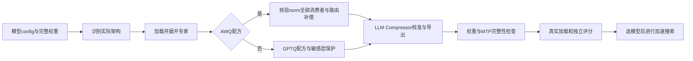

# Qwen 量化适配与验证边界

InferBoost 按 `config.json` 的实际架构及加载后的模块结构选择适配器，不按模型目录名称判断支持情况。新量化统一使用 LLM Compressor，支持的结构可以比较 AWQ-W4A16、GPTQ-W4A16、GPTQ-W8A16、AWQ＋GPTQ-W4A16 和 GPTQ-W8A8；具体配方还需通过硬件、导出、加载和独立评测。

| 结构标识 | 适配方式 | 运行检查 |
| --- | --- | --- |
| `qwen2`、`qwen3` | 上游稠密模型映射 | 加载结构、导出与独立质量评测 |
| `qwen3_5`、`qwen3_5_text` | 上游混合注意力稠密映射 | 混合注意力模块与敏感投影保护 |
| `qwen2_moe`、`qwen3_moe` | 完整MoE分支映射 | 完整消费者映射、路由补偿与量化后评测 |
| `qwen3_next` | 混合注意力＋完整MoE分支映射 | 完整消费者映射、路由补偿与量化后评测 |
| `qwen3_5_moe`、`qwen3_5_moe_text` | 混合注意力＋完整MoE分支映射 | 混合注意力、专家分支与路由补偿 |

模型发布名称可以复用这些结构，但新增未知 `model_type`、自定义远程代码、不同路由公式、视觉/音频专用结构不自动获得支持。本工具当前评测的是文本路径。结构检查通过不等于所有参数规模、硬件和业务评分均已验证。



## 在镜像中使用

运行 `quickstart`，输入完整精度模型路径和可选MTP路径即可。模型识别和适配自动执行，无需手动选择“MoE模式”。选择 `all` 会尝试当前架构及GPU可用的配方；不满足条件的项目在报告中列出原因。

也可以明确指定五种INT配方，默认在选择点等待用户确认：

```bash
export PIPELINE_WORKSPACE=/your-persistent-volume/inferboost
quickstart workflow \
  --model /models/full-precision \
  --mtp-model /models/mtp \
  --recipes awq4,gptq4,gptq8,awq_gptq4,w8a8 \
  --mode standard
```

没有MTP时省略 `--mtp-model`。同一主模型的量化候选共用被冻结的校准数据，质量测试另用独立数据。只有明确添加 `--auto-select` 才会按照当前质量门槛和选择偏好自动走完后续阶段。输入模型权重不会被覆盖。

## AWQ 与 MoE 路由

AWQ 会缩放归一化层输出，并对消费同一输出的权重做反向补偿。适配器显式包含 routed experts、shared expert、主路由器及共享专家门控。路由器和共享门控保持BF16，但需要等价缩放；“不量化”不等于“完全不允许缩放”。

实现位于 `pipeline/qwen_awq.py`，通过 `AWQModifier(mappings=...)` 传入，不写入共享site-packages。校准开始时核对实际解析的消费者集合，发现遗漏、额外分支或路由器被量化即停止。未知/未展开专家结构不回退为猜测映射。

Qwen的offset RMSNorm转换、MoE专家展开、缩放搜索、GPTQ误差补偿及compressed-tensors导出继续使用上游实现。MTP不加载到校准模型中，导出后逐张量SHA256检查其未变化。GDN敏感投影、词嵌入、输出头继续保持高精度。

## 大 MoE 的校准回放

专家多时，逐专家、逐样本、逐搜索点调用小矩阵会产生大量CPU调度与GPU启动开销。适配器将线性层和已核验Qwen MoE前馈层的缓存按最多32768个token合并回放；这些运算在token之间独立。样本及token没有删减，AWQ仍使用上游的20点搜索和按元素归一化的MSE目标。注意力模块、带损失掩码的数据和未知参数布局保持上游逐样本方式。

批量矩阵计算允许正常的浮点舍入差异，因此需比较完整模型导出后的质量。`awq_adapter.json`记录回放策略与分支核验结果。该优化减少调用次数，不是内存上限；模型、校准长度和专家数仍决定缓存规模。

适配器在一次平滑阶段中复用 eval 上下文，减少逐映射重复遍历模型子模块的开销；阶段退出（包括异常）时恢复原方法。各映射的缓存、offload 与计算上下文仍按上游执行，收益以具体模型的计时与质量评测为准。

## 验证

在量化环境执行 `python scripts/validate_qwen_awq.py --output /workspace/qwen-check.json`，检查四种真实MoE模型类的小配置：通过上游实际缩放操作验证输出、路由分数和专家选择，故意撤销路由补偿的负例必须被检出。这是结构验证，不能代替完整模型BF16量化与业务数据评测。

模型接入可先用小批校准验证导出和加载，再使用标准校准与业务数据评测。默认 100 条工程题与用户业务集分开报告，量化阶段统一关闭 MTP。记录量化内存峰值、真实压缩格式、加载内核与退化题；资源预算见[配置指南](configuration.md)。

FP8 配方要求 SM89 起，W4AFP8 要求 SM90 起且当前不准入 MoE。模型结构适配与 GPU 内核支持分别检查。
