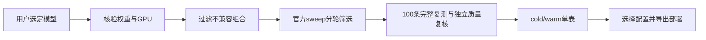

# 第二阶段：选定模型的推理加速

## 默认加速设置（开始前先了解）

- **普通KV Cache：默认开启**。生成下一个token时复用此前计算过的Key/Value，避免重复计算历史内容。
- **前缀缓存：默认开启**。跨请求复用相同前缀的计算结果；没有重复前缀时不一定受益。
- **分块预填充：默认开启**。把长输入拆成多块处理，便于调度其他请求。
- **KV精度：auto**。交给运行框架按模型配置决定；它与W/A量化精度是两回事。

本搜索默认启用这些功能，没有分别做开关消融；实际启动命令中的值保留在工程记录中。MTP草稿保持原精度，不参与主模型量化；是否启用MTP解码取决于用户输入和后续测试。

输入是已有的Hugging Face safetensors模型目录，或第一阶段`selected_model.json`。第二阶段不执行量化、不改源权重，也不负责合并模型。普通用户只需输入模型目录并启动；运行环境由镜像或`configs/inference.local.json`预先配置。

```bash
./accelerate
# 等价入口：
./quickstart accelerate

./accelerate run --model /models/selected-quantized --config configs/inference.local.json --run-id my-inference
./accelerate run --model /workspace/runs/my-quantization/selected_model.json --run-id my-inference
./accelerate run --model /workspace/runs/my-quantization/selected_model.json --run-id my-inference --wait-for-gpu 1800
./accelerate status --run-id my-inference
./accelerate report --run-id my-inference
./accelerate select --run-id my-inference --profile recommended
./accelerate serve --run-id my-inference --smoke-test
./accelerate serve --run-id my-inference --host 0.0.0.0 --port 9001
```

## 复用的上游能力

服务的启动、健康等待、参数组合、重复轮次、失败记录和恢复使用**已安装的vLLM 0.33.0官方sweep**，不复制或修改其源码。`pipeline.inference.native`只适配信号处理，实际执行`vllm.benchmarks.sweep.serve.run_main`。自定义 benchmark 钩子执行逐请求 cold/warm 协议，官方仍保存每组和每轮原始结果。

官方sweep汇总结果需要pandas等额外依赖，见`requirements/inference-bench.txt`；仅安装vLLM推理包可能缺少这些依赖。已有推理环境不能改动时，可将它们单独安装到项目目录，再由`runtime.benchmark_site`指向该目录。包装启动命令显式传递host/port，供官方扫描器探测正确的健康检查地址。

- [v0.33官方参数扫描文档](https://docs.vllm.ai/en/v0.33.0/benchmarking/sweeps/)
- [v0.33调优说明](https://docs.vllm.ai/en/v0.33.0/configuration/optimization/)
- [量化与矩阵后端](https://docs.vllm.ai/en/v0.33.0/features/quantization/)
- [CUDA Graph设计](https://docs.vllm.ai/en/v0.33.0/design/cuda_graphs/)

## 默认搜索



默认按Attention、矩阵内核、Graph/编译、调度预算、MTP分轮筛选，保留前几个候选。小批代表性数据只用于筛选；最终保留基准和前两名，用完整数据、并发1、cold/warm、各3轮复测。配置上限限制筛选启动数，避免无界组合爆炸。这是本轮候选中的实测最优，不保证覆盖所有组合。

可选轴包括FA2/FA3/FlashInfer、auto/Marlin/Humming、无Graph/分段/完整加分段Graph、2048/4096/8192调度预算、MTP0/1/2。以模型和真实GPU筛选：GPU 不满足当前 FA3 实现的 Hopper 条件时跳过；没有Humming依赖就跳过；没有匹配BF16 MTP就跳过；A8不使用A16 Marlin候选。编译与Graph拆开，无Graph可以继续使用编译；Eager参照会明确关闭编译和Graph。

`--strategy full`扫描所有兼容组合；组合数超过`max_trials`时拒绝执行，需显式修改配置。`plan --sm 80`只查看离线规则，不表示实际依赖/GPU/加载已通过。

## 两阶段交接

读取第一阶段`schema_version=1, stage=quantization_selection`的选择文件：接受通过推荐门槛的模型，或包含明确用户选择记录的模型。后一种保留原质量对照结果，不把用户选择写成质量通过。检查第一阶段加载配置指纹，实际准备后再核对模型分片SHA256。继承`mtp_source`，但草稿默认单独保持BF16，不因主模型是W4A8就一起量化。直接传模型目录时不声称已评估量化损失。

兼容识别AWQ、GPTQ和compressed-tensors量化元数据；识别不等于任意架构和格式已经通过GPU验收。已选模型的激活精度必须保留；W4AFP8当前适配要求SM90，无法从加载审计确认A8时排除候选，不用回退A16的速度冒充结果。其他未知格式仅交给原生auto尝试加载，失败保留原因。

## 结果与部署

结果在`runs/inference/<id>/`：输入、模型清单、代码快照、GPU/依赖、兼容计划、官方sweep原始结果、加载审计、逐请求SSE结果、报告、部署资料分别保存。主报告表格只有一张，每行是完整复测的候选，cold/warm各列TTFT、E2E、TPS均值。`search-details.html/json`另列所有初筛候选、实际内核、逐阶段新增测试数量、跳过项与默认配置。筛选小样本不会混入完整复测均值，也不影响既有候选ID和推荐规则。

报告使用“算法＋W/A精度”，例如GPTQ-W8A16与GPTQ-W8A8分别表示仅权重量化、权重与激活均量化。本流程仅权重量化配方的激活保持BF16；INT8/FP8激活会单独注明动态量化。A描述被量化线性层的输入，不表示累加或KV精度；MTP和受保护模块不随之量化。若直接传入外部量化模型且没有算法记录，标为“算法未记录”，不会从compressed-tensors格式猜测GPTQ或AWQ。

`search-details.html`默认按五步呈现：注意力、量化矩阵内核、编译/Graph、调度预算、MTP。顶部路线图可以点击跳转；每步写明作用、固定条件和本步选项，主表仅展示领先组合在相同其他条件下的比较。此前已测配置会带回对照表，注明“复用前面已测成绩”；其他父配置的比较和保留名单可以展开查看。所有原始组合的记录仍保留在页面末尾及JSON中。

五步解释从当时已存在的初筛数据重建，不将最终结果倒填成早期决定。后续加入 MTP 等参数可能改变先前配置的排名，因此最终配置以完整复测结果为准。页面分别标注“本步领先”和“最终配置”，保留两者差异。完整网格或只有固定配置验证的批次不伪造五步决策。只有同样本数、同轮次、相同其他参数的成绩才放进同条件对比表。

默认KV Cache、前缀缓存、分块预填充开启，KV dtype=auto。默认搜索不单独比较这些项的开关。cold请求前清除前缀缓存，warm紧接着重复同一请求；两者均已预热，cold不是冷启动。普通KV Cache是生成过程中的复用机制，与跨请求前缀缓存不同。

第二阶段基准是已选模型的基础配置，默认仍含编译、FULL_AND_PIECEWISE Graph和前缀缓存；不能标为“完全未优化的原模型”。第一阶段若用quality100、第二阶段用public100，不能将两个加速比相乘。需要另外在同一批public100上测试原始BF16、已选量化基础配置、量化优化配置，才能报告整个流程的同口径提升。

分阶段搜索保留所有已测候选中当前排名靠前者，不是逐项选定后穷举剩余选项；后期没有重新覆盖所有早期落选项。例如auto在MTP0时落选，不代表auto＋MTP2已经被测试或一定更慢。可选择完整网格；更节省资源的后续验证是围绕最终方案，补测注意力、矩阵内核、Graph与MTP的交互组合。报告中的“本轮推荐”不代表全局最优。

实际内核相同的auto/显式候选去重；没有足够内核证据时不猜测重复。无错误/截断且所有重复轮次齐全才可推荐与部署。默认性能数据是`data/public100.json`；若存在`data/quality100.json`，另做独立带答案复核，其请求不计入性能均值。质量复核复用第一阶段规则评分，低于同模型基准的候选在表内标注并排除推荐；需要质量对照而基准不完整时，暂不推荐或导出部署。没有答案时不输出准确率。全部原始回答保留，少量通用规则题不等于业务质量验收。报告另记生成器SHA256，性能原始记录和冻结的测试代码保持独立。

选择后导出模型/MTP引用、权重SHA、GPU和版本、实际启动参数、环境、健康检查和`start.sh`。启动前复核原权重与加载视图配置、MTP索引和审计参考的SHA256，变动后需要重新测试。独立accelerate命令导出的历史配方依赖匹配环境、快照代码和原模型路径。统一workflow另生成可迁移部署包，由公共镜像启动；两种包都不包含权重。`--smoke-test`用真实请求验证后停止。实际对外服务应由平台配置认证、TLS与健康检查宽限时间。

## 资源与恢复

与第一阶段共用项目级兼容锁及按物理GPU UUID区分的设备锁，GPU已有服务时不停止他人进程。只启动和结束本轮官方sweep创建的进程。首轮编译不计入TTFT/E2E。`run ... --resume`要求相同配置、输入和GPU；模型变化会拒绝续跑。官方只部分完成的重复轮次会保留记录，并在恢复时补测缺失轮次。

量化后端、配方与模型选择见[第一阶段](quantization-architecture.md)，资源和端口参数见[配置指南](configuration.md)。
